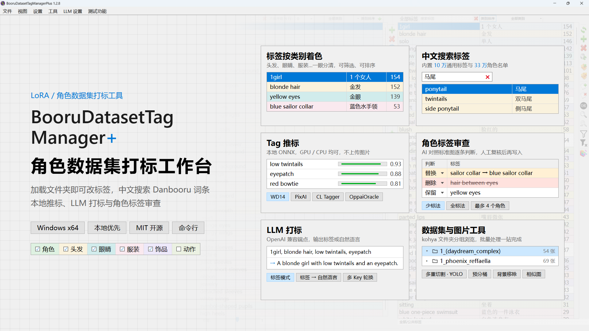

<div align="center">

# BooruDatasetTagManager+ 1.2.8

A Windows tagger for LoRA and character datasets

[简体中文](README.md) · [Português do Brasil](docs/pt-BR/README_pt_BR.md)

[](https://github.com/storyAura/BooruDatasetTagManagerPlus/releases)   [](LICENSE)

</div>



Each image has a matching `.txt` file for its tags: load a folder and edit them. You can also auto-tag with the local Tag tagger or an LLM, audit character tags, and search Danbooru tags in Chinese. The UI defaults to Simplified Chinese and can be switched to English. Forked from [starik222/BooruDatasetTagManager](https://github.com/starik222/BooruDatasetTagManager).

[Download](https://github.com/storyAura/BooruDatasetTagManagerPlus/releases) · [Feature guide](docs/FEATURES_en.md) · [Release notes](docs/RELEASE_NOTES_v1.2.8.md) · [Issues](https://github.com/storyAura/BooruDatasetTagManagerPlus/issues)

## Features

- **Tag editing**: undo / redo, weights, multi-select bulk edits; All Tags counts every tag and filters images with AND / OR / NOT / XOR
- **Chinese tag search**: about 100k general tags and 330k character names built in; typing 头发 finds `long hair` and `black hair`; tags are tinted by category and can be filtered and sorted
- **Tag tagger**: local ONNX models (WD14 / PixAI / CL / OppaiOracle) on GPU or CPU; images never leave your machine
- **LLM tagging**: any OpenAI-compatible endpoint, output as tags or natural-language captions
- **Character tag audit**: an AI checks tags against a reference image, removes wrong ones and adds colors; sparse or full style, up to 4 characters, nothing is written until you review it
- **Image tools**: image editor, batch crop, multi-crop (incl. YOLO), pre-bucket, background removal
- **Dataset cleanup**: kohya folder-group browser, similar images, corrupted-file scan, classify into folders by tag, video frame extraction
- **Command line**: the same exe runs headless for bulk tag edits, tagging, and audits

## Getting started

**Requirements**: Windows 10 / 11 x64. The release package is self-contained, so no separate .NET install is needed. Only LLM tagging and the character tag audit need an API; everything else works offline.

1. Download `BooruDatasetTagManagerPlus-*-win-x64.zip` from [Releases](https://github.com/storyAura/BooruDatasetTagManagerPlus/releases) and extract it
2. Run `BooruDatasetTagManagerPlus.exe`
3. **File → Load Folder**, pick your dataset folder, and start editing tags
4. Before using LLM features, fill in the endpoint, key, and model under **LLM Settings** in the menu bar

| To do this | Go to |
| --- | --- |
| Auto-tag | Tools → Tagging tools → Tag tagger / LLM tagging |
| Audit character tags | Tools → Tagging tools → Character tag audit |
| Crop, remove backgrounds, bucket | Tools → Processing tools / Preprocessing tools |
| Script batch jobs | `BooruDatasetTagManagerPlus.exe help` |

Every feature is described with screenshots in the **[feature guide](docs/FEATURES_en.md)**.

### Build from source

```powershell
dotnet build BooruDatasetTagManager.sln -c Debug -f net8.0-windows
dotnet test BooruDatasetTagManager.Tests\BooruDatasetTagManager.Tests.csproj
```

`quick_build.bat` packages a self-contained build into `dist/` (it downloads FFmpeg the first time).

## Changelog

- **1.2.8** (current) — Tag tagger adds PixAI Tagger v1.0 and WD EVA02 2026 Canary, on GPU or CPU; a find window for image tags (thanks @furjifurji #1); the character audit no longer invents colored tags, its temperature is adjustable, and network errors are retried. [Release notes](docs/RELEASE_NOTES_v1.2.8.md)
- **1.2.7** — Tag tagger adds OppaiOracle; the character audit walks tags one by one; multi-crop YOLO no longer misses small boxes. [Release notes](docs/RELEASE_NOTES_v1.2.7.md)
- **1.2.6** — ONNX tagger renamed Tag tagger; grouped Tools menu; Win10 native-library loading and large-batch tagging memory hardened. [Release notes](docs/RELEASE_NOTES_v1.2.6.md)

Older versions are on [Releases](https://github.com/storyAura/BooruDatasetTagManagerPlus/releases) and in the release notes under [docs](docs/).

## FAQ

- **Are my images uploaded?** The Tag tagger, background removal, and video tools run on your machine. Only LLM tagging and the character tag audit send images to the endpoint you configured.
- **Where are settings stored?** In `Documents\BooruDatasetTagManagerPlus\settings.json`, with API keys encrypted by DPAPI. The `Models/` and `Cache/` folders beside the exe are safe to delete; models can be downloaded again from inside the app.
- **How do I report a problem?** Turn on debug mode under Settings → General, reproduce the problem, and attach `debug.log` (and `crash.log` after a crash) from the program folder to an [issue](https://github.com/storyAura/BooruDatasetTagManagerPlus/issues).

## Contributing

Issues and pull requests are welcome. Please make sure `dotnet test` passes, and add any new UI text to all 5 language files in `BooruDatasetTagManager/Languages/`.

## Acknowledgments & license

- **[starik222](https://github.com/starik222)** — author of [BooruDatasetTagManager](https://github.com/starik222/BooruDatasetTagManager), which this project builds on
- **[FFmpeg](https://ffmpeg.org/)** — video processing (GPL component bundled in Releases)
- Licensed under the [MIT License](LICENSE); retain upstream copyright notices when redistributing modified builds
